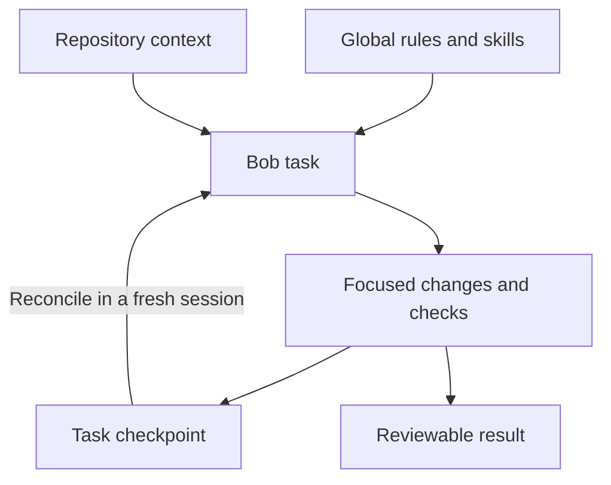

# A practical guide to IBM Bob on substantial codebases

Reviewed against public documentation on **9 October 2026 (UTC)**. This guide accompanies Bob Workflow Kit 0.1.0-alpha.2. Start with [Try the alpha](try-alpha.md) for the shortest installation-to-first-task path.

## 1. Choose the outcome you want from the setup

A useful setup helps Bob find the right files, connect changes across components, run meaningful checks, and leave enough evidence to resume. Repository size alone is a poor task boundary: changing one parser in a large monorepo may need a small set of files, while changing an authentication contract may require careful investigation across several services.

Write the desired behaviour and acceptance criteria before deciding how much automation to add. For example: “Add pagination to this endpoint while preserving the existing client contract; show which callers changed and run the relevant server/client checks.” That gives Bob a reason to search for the API, callers, contracts, and tests.

IBM's [large-project guidance](https://bob.ibm.com/docs/ide/core-concepts/large-projects) and [context-management documentation](https://bob.ibm.com/docs/ide/core-concepts/context-window-management) are the product references. Context capacity and compaction behaviour can change between versions, so this guide does not prescribe one fixed token limit.

## 2. Understand the building blocks

| Building block | What it contributes | How this kit uses it |
| --- | --- | --- |
| Global rule | Persistent operating instructions across projects | One concise rule for scoping, investigation, progress, and verification |
| Repository instructions | Project-specific architecture, constraints, and commands | Preserve existing `AGENTS.md` and maintain a small repository profile |
| Skill | A reusable workflow activated when relevant | One skill with onboarding, change, and recovery references |
| Task memory | Durable records that a future conversation can inspect | One concise checkpoint per task, tied to current files and evidence |
| Tools | Actual file operations, commands, and integrations | Use existing Bob tools; the installer itself is ordinary local Python |
| Subagents | Separate investigations with their own task context | Delegate independent, bounded work when it helps |
| Hooks | Code that runs at supported lifecycle events | No hooks installed by default |
| Plugins | A distribution bundle for related configuration/assets | Native packaging is a later compatibility target |
| Controller | External code deciding what step can happen next | A later optional project, not an existing feature of this kit |

Global rules are documented in both [IDE](https://bob.ibm.com/docs/ide/configuration/rules) and [Shell](https://bob.ibm.com/docs/shell/configuration/bobshell-custom-rules). Skills and their supporting files are documented in [IDE skills](https://bob.ibm.com/docs/ide/features/skills) and [Shell skills](https://bob.ibm.com/docs/shell/features/skills). “Task memory” here means our explicit files; it is not a claim that Bob has unlimited automatic memory.

The checkpoint carries selected task facts across sessions. Current files and real check results remain the evidence for the implementation.

## 3. Install the minimum useful foundation

Use the commands in [README](../README.md). Preview first to see the actual target and collisions. Install the package, then run `doctor`. Start a fresh Bob conversation and use [the verification prompt](../prompts/verify.txt).

There are three different observations to record:

1. **Files exist and validate.** The installer can establish this for the packaged files.
2. **Bob loaded the rule and skill.** Confirm in the actual client, including any settings/picker evidence. Manually reading a file does not prove automatic loading.
3. **Bob used the workflow successfully on a task.** Inspect its changes, real checks, and handoff.

Keep those observations separate. A checksum is useful installation evidence; it is not a behavioural guarantee.

Use the smallest useful global instructions. Detailed references should be read when a task needs them, and project facts should stay in the project. Global rules should never accumulate the architecture and transcripts of every repository you visit.

## 4. Onboard a repository without reading everything

Open the repository and give Bob [onboard.txt](../prompts/onboard.txt). It should first locate existing instructions and inspect the working tree, so it understands the project and preserves unrelated work.

Useful initial evidence usually includes manifests, lockfiles, CI configuration, build scripts, component entry points, dependency declarations, and representative tests. Let those guide further searches. A directory listing alone does not reveal architecture, and reading every implementation file rarely provides a maintainable starting map.

The resulting repository profile should identify:

- The main components and their interfaces, with supporting paths.
- Actual build, test, lint, and formatting commands and their working directories.
- Required local services, fixtures, environment-variable names, credential mechanisms, and platform limitations. Never record credential values.
- Existing failures and checks that were not run.
- Important project constraints and links to maintained documentation.

Do not invent a test command based only on a language. Two Python projects can use different test layouts, databases, and preparation steps. Record command arguments and working directories explicitly so the same check can be reproduced later.

Keep root `AGENTS.md` concise. A pointer to a detailed profile helps discovery, but do not assume every linked document is automatically injected into Bob's context.

## 5. Work in coherent milestones

For a substantial request, identify the acceptance criteria and affected interfaces, then make a plan proportional to the uncertainty. A milestone should produce something assessable: a contract update, a working backend path, a client integration, or a completed regression check.

Use targeted searches to move from public interface to implementation, callers, and tests. Broaden when the evidence demands it. An arbitrary “never read more than ten files” rule can be as harmful as indiscriminate full-repository reading.

Subagents help when they answer independent questions and return concise evidence. A good delegation names the question, allowed scope, relevant constraints, and expected output. For example: “Find consumers of this response field; return paths, usage patterns, and tests that exercise them.” Parallel mutation needs explicit ownership or separate worktrees and a clear integration step.

For a small spelling fix or a well-understood one-line change, make the change directly and verify proportionately. The workflow should not require a project plan and several agents for every request.

## 6. Make command output useful

Before running a command, know what decision its result will support. Run it in the right working directory with the expected environment. Distinguish a long-running build or server from a completed check, and inspect existing processes before starting duplicates.

For large output, keep a local log and bring back a bounded excerpt with the actual exit status and log path. Include the relevant error and context rather than only the final line. If output is truncated, say so; a truncated log is not complete evidence.

Avoid large compound shell commands whose individual failures become hard to interpret. A successful wrapper or pipeline does not automatically establish that every child command succeeded. Prefer existing project scripts for complex preparation, and record which command failed.

Logs can contain sensitive data. Keep diagnostics local and review them before sharing an issue. The starter kit does not implement automatic secret redaction.

## 7. Keep task memory small and attributable

Use the [checkpoint template](../payload/skills/work-large-codebase/templates/checkpoint.md). Each record should answer: What are we trying to accomplish? What has changed? What evidence exists? What remains? What is the next useful action?

Store one record per task, in the repository convention chosen during onboarding. Include revision/worktree information and the relevant paths. Record failed approaches concisely so a fresh session does not repeat them without new evidence.

A useful checkpoint preserves decisions and references, not a transcript of every thought or tool call. Update it at meaningful milestones and before a handoff. Constantly rewriting a large diary consumes time and creates another source of inconsistency.

The record is a claim about a past state. On recovery, reconcile it with disk, branches, running processes, and saved check output. A later edit can make an earlier successful test result irrelevant. If inputs are not known, call the old verification uncertain and rerun the focused checks needed for the current state.

Keep repository-specific memory out of global rules. Do not move private task records into a public skills repository. The installer does not automatically change Git ignore rules or commit generated evidence.

## 8. Define what “done” means

Completion should connect the user's outcome to actual observations. Report the implemented behaviour, relevant changes, checks run, their scope and results, and unresolved limitations.

Use precise statuses. “Implemented; integration tests blocked by a missing local database” is more useful than “All done” or an unexplained failure. A pre-existing failing test should be distinguished from a regression introduced by the change, without quietly removing it from the acceptance criteria.

Passing a formatter demonstrates formatting. Passing a unit test demonstrates the tested behaviour. Neither alone proves production readiness, scalability, deployment correctness, or the absence of all defects.

The kit's global rule asks Bob to use these distinctions. It cannot independently prevent a model from making an inaccurate statement. Where a workflow needs mandatory stages, an external controller should decide acceptance from real results and record why it stopped.

## 9. Recover when progress stalls

Use [resume.txt](../prompts/resume.txt) in a fresh session. Give it the exact checkpoint path so it can reconcile a focused set of files rather than reconstruct the whole previous conversation.

If repeated attempts fail, classify the obstacle: code defect, test/environment problem, missing prerequisite, denied permission, authentication issue, tool mismatch, or stale understanding. These require different responses. Retrying the same command indefinitely is not a recovery strategy.

Preserve useful partial work and report a concrete blocker. Respect the existing permission mechanism; a workflow file does not grant new access. Ask a focused question only when the answer changes the task materially and cannot reasonably be inferred.

## 10. Add skills, hooks, MCP, and plugins when they solve a specific problem

Start with the [ecosystem guide](ecosystem.md). Before adopting a package, inspect its actual files, intended client/version, dependencies, licence, and operations. Pin the source version when reproducibility matters. Similar filenames across coding agents do not establish compatible tool names or settings.

A skill can be reusable even if its environment-specific tool calls require adaptation. MCP adds a way to reach an external capability; it does not enlarge context without cost or decide whether a task succeeded. Keep integration credentials in the integration's supported secret mechanism.

Hooks are suitable for narrowly defined lifecycle work when the installed client documents the event and outcome. Check the actual [IDE hook contract](https://bob.ibm.com/docs/ide/configuration/lifecycle-hooks) or [Shell hook contract](https://bob.ibm.com/docs/shell/configuration/lifecycle-hooks). Avoid model-calling loops or whole-project test suites on every hook.

IBM's [October 1 release post](https://bob.ibm.com/blog/september-2026-release/) documents plugin directories and continued support for the existing rules/skills layout. This kit uses the clearer common layout first. A native bundle and a public Marketplace listing are separate release tasks requiring their own evidence.

## 11. Treat stricter automation as another component

A future controller can validate a task profile, invoke a bounded `bob run`, execute checks outside the model loop, and choose accept, repair, or stop. It must handle real process status, timeouts, cancellation, missing prerequisites, changed verification inputs, and finite budgets.

IBM's [non-interactive Shell documentation](https://bob.ibm.com/docs/shell/getting-started/start-bobshell-non-interactive) describes structured output, turn/cost options, and tool restrictions. It also documents separate API-key authentication and pre-approved enabled tools in `bob run`. Those details matter when designing automation.

The starter release does not include that controller. Its installed instructions remain useful independently. Installing any later controller will govern explicitly launched tasks, not automatically intercept every IDE interaction.

## 12. Share evidence that improves the project

Contribute a small reproducible case, the kit version, OS, Bob interface/version, relevant paths, actual command/result, and what you expected. Use sanitised examples. Mark untested combinations honestly.

For performance experiments, compare the same task, starting revision, environment, available tools, and evaluation criteria. Repeat runs because agent outcomes vary. Track completion quality, regressions, recovery, elapsed time, command volume, and reported usage together; fewer commands alone can mean inadequate investigation.

The long-term goal is a maintainable set of workflows and examples whose limits are visible. The first useful milestone is a person installing the kit, completing a representative task, and resuming it successfully with enough evidence for someone else to assess the result.
